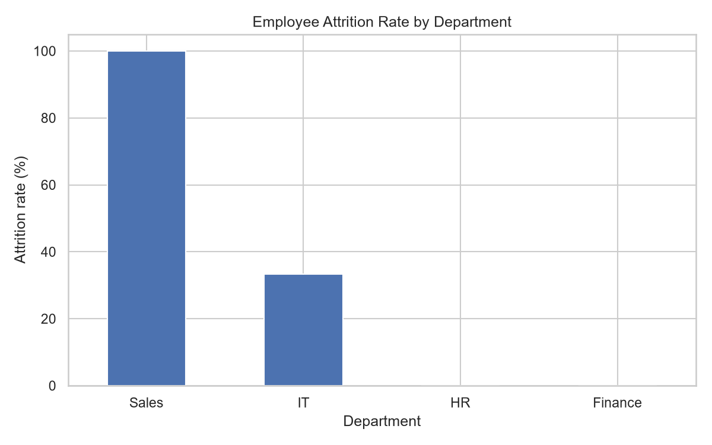

# Employee Attrition and Workforce Analytics

**A Python-based HR analytics project exploring employee attrition, departmental workforce patterns, and data-driven HR decision-making.**

## Project Overview

Employee attrition is an important workforce management challenge. Understanding where employee departures occur can help Human Resources teams investigate retention risks, improve employee experience, and support workforce planning.

This project demonstrates how Python can be used to organize HR data, calculate departmental metrics, and create visualizations that support evidence-based decision-making.

> **Data note:** The current dataset contains synthetic employee records created for demonstration and learning purposes. It does not represent real employees or actual company results.

## Project Objectives

- Analyze workforce data using Python.
- Calculate and compare departmental attrition metrics.
- Summarize HR data into an accessible CSV report.
- Visualize departmental attrition patterns.
- Demonstrate how HR analytics can inform workforce planning and retention strategies.

## Tools and Technologies

- **Python** — data analysis and scripting
- **Pandas** — data manipulation and aggregation
- **NumPy** — numerical operations
- **Matplotlib** — data visualization
- **Seaborn** — statistical visualization

## Repository Structure

```text
hr-analytics-employee-attrition/
├── hr_attrition_analysis.py
├── outputs/
│   ├── department_attrition.csv
│   ├── department_attrition.png
│   └── synthetic_hr_data.csv
├── .gitignore
└── README.md
```

## Project Outputs

### Departmental Attrition Visualization

The chart below presents the departmental attrition analysis generated by the Python script.



### Generated Files

| File | Description |
|---|---|
| `outputs/department_attrition.csv` | Department-level attrition summary |
| `outputs/department_attrition.png` | Generated attrition visualization |
| `outputs/synthetic_hr_data.csv` | Synthetic employee dataset used for the analysis |

## How to Run the Project

### 1. Clone the repository

```bash
git clone https://github.com/eadeyinka/hr-analytics-employee-attrition.git
cd hr-analytics-employee-attrition
```

### 2. Install the required libraries

```bash
python -m pip install pandas numpy matplotlib seaborn
```

### 3. Run the analysis

```bash
python hr_attrition_analysis.py
```

The script generates the departmental summary, visualization, and synthetic dataset in the `outputs/` directory.

## HR and Business Applications

This type of analysis can help HR teams:

- Monitor employee attrition across departments.
- Identify workforce patterns that warrant further investigation.
- Support evidence-based employee retention initiatives.
- Improve workforce reporting and HR decision-making.

These are potential applications of the analytical approach, not verified findings about a real organization.

## Limitations and Future Improvements

The current version uses a small synthetic dataset to demonstrate the analysis workflow. Its results should not be treated as statistically representative or used to make real employment decisions.

Planned improvements include:

- Expanding the analysis using a larger, documented dataset.
- Comparing attrition rates across departments and employee groups.
- Investigating potential relationships between attrition and factors such as tenure, overtime, job satisfaction, and compensation, where suitable data is available.
- Adding interactive Power BI dashboards.
- Developing evidence-based recommendations supported by the results.

## Author

**Elijah Adeyinka**

M.Sc. Digital Transformation Leadership | HR Analytics | People Analytics | Data Analysis

GitHub: [@eadeyinka](https://github.com/eadeyinka)

---

*This project is part of my professional portfolio demonstrating the application of data analytics to Human Resources and workforce management.*
